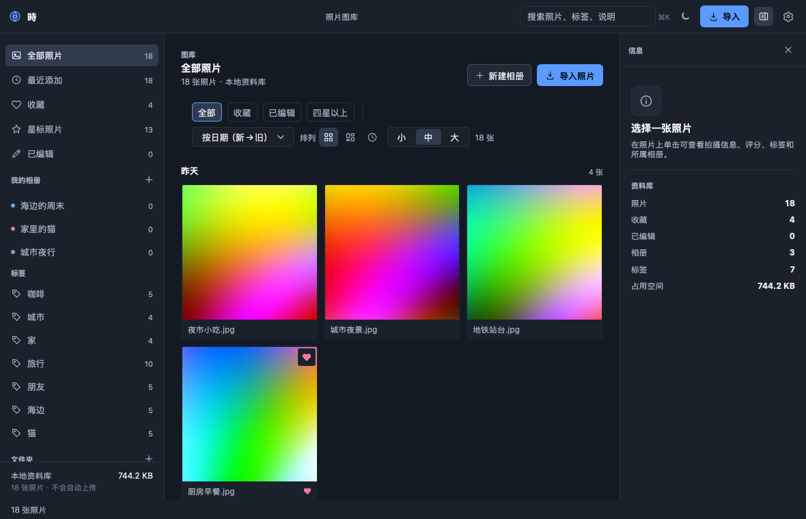
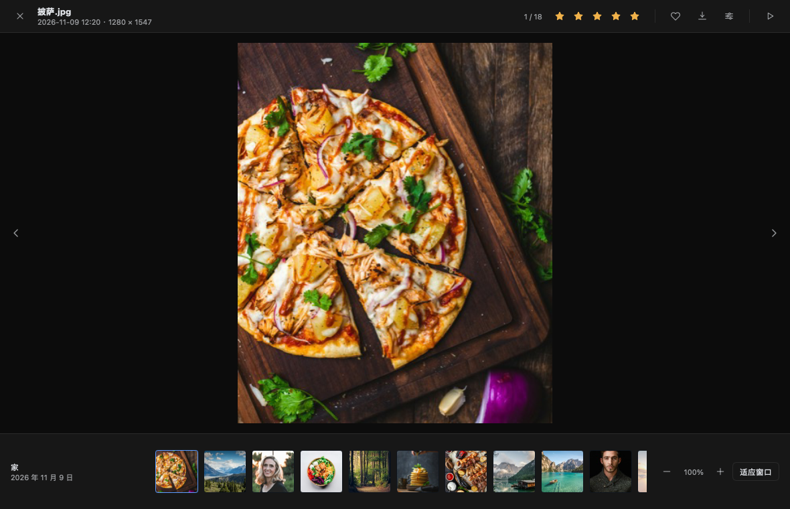
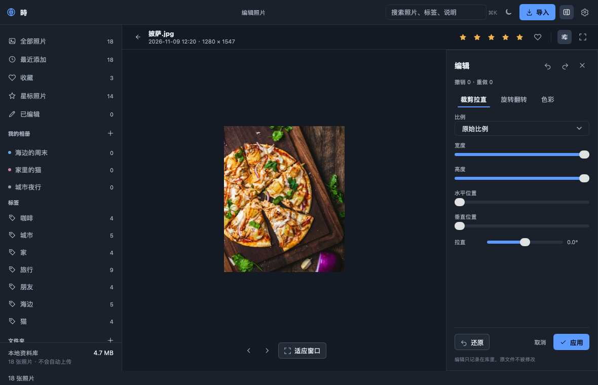

# 時 · Toki

A local-first photo library, built as a native desktop app in pure Go.
纯 Go 的本地照片库：原生三栏界面、非破坏性编辑、完全离线。

[](https://github.com/ilinmu/Toki/actions/workflows/ci.yml)
[](https://github.com/ilinmu/Toki/releases)
[](LICENSE)



## 特性

- **照片墙**：网格按日期分组、瀑布流按最矮列、时间轴；只构建可见卡片，万级照片也能立刻打开。
- **查看器**：深色舞台、胶片条、滚轮以光标为中心缩放（10%–800%）、拖动平移、幻灯片。
- **整理**：星标、收藏、标签、相册、按文件夹与年份浏览、组合搜索（文本 × 星级 × 来源 × 排序 × 筛选）。
- **非破坏性编辑**：裁剪（比例预设）、拉直、旋转翻转、曝光 / 对比度 / 饱和度 / 色温 / 暗角，逐张撤销重做。
  缩略图、预览与导出共用同一份渲染结果。
- **导出**：8 档尺寸、4 档质量、文件名加序号、水印。
- **元数据**：读 EXIF（相机、ISO、光圈、曝光、焦距、GPS、拍摄时间）；写 XMP（JPEG 内嵌，其它格式写边车）。
- **监视文件夹**：新照片自动出现；原文件永远只读。
- **格式**：JPEG、PNG、GIF（动画会播放）、BMP、WebP、TIFF。
- **纯本地**：不联网、无账号、无遥测；库保存在 `~/Library/Application Support/Toki/`（Linux 为 `~/.config/Toki/`）。

## 下载

macOS、Linux、Windows 的安装包在 [Releases](https://github.com/ilinmu/Toki/releases)：

| 平台    | 产物                                      |
| ------- | ----------------------------------------- |
| macOS   | `toki-<版本>-universal.dmg`               |
| Linux   | `toki-<版本>-linux-<架构>.tar.gz`、`.deb` |
| Windows | `toki-setup-<版本>-<架构>.exe`            |

macOS 构建为 ad-hoc 签名（未公证），首次打开需要在「系统设置 › 隐私与安全性」里允许。

## 从源码构建

需要 Go 1.27+；不需要 Node、cgo 或 Xcode（打包 dmg 需要 macOS）。

```sh
cd app
go tool mygo dev      # 开发模式
go test ./...         # 无窗口测试
go tool mygo build    # 打包到 build/
```

想用示例照片试：`TOKI_SEED="$PWD/testdata/demo-photos" go tool mygo dev`。

## 开发

```sh
make test    # go test ./...（在 app/）
make lint    # gofmt、go vet、mygo vet、staticcheck
make build   # 当前平台的安装包
```

更多内容：

- [`docs/architecture.md`](docs/architecture.md) — 模块、数据模型、缩略图、编辑与监视
- [`docs/ui.md`](docs/ui.md) — 界面结构、Token 与交互约定，截图说明
- [`docs/decisions.md`](docs/decisions.md) — 工程取舍
- [`docs/todo.md`](docs/todo.md) — 明确推迟的功能
- [`CONTRIBUTING.md`](CONTRIBUTING.md) — 提交流程与代码风格
- [`SECURITY.md`](SECURITY.md) — 安全问题怎么报

## 键盘

| 键           | 作用                               |
| ------------ | ---------------------------------- |
| ⌘K           | 聚焦搜索框（输入即筛选，Esc 清空） |
| ⌘⇧K          | 命令面板                           |
| ⇧⌘L          | 深色 / 浅色外观                    |
| ⇧⌘I          | 显示或隐藏照片信息                 |
| ⌘1 / ⌘2 / ⌘3 | 网格 / 瀑布流 / 时间轴             |
| ⌘O / ⌘R / ⌘E | 导入文件夹 / 刷新库 / 导出         |
| ⇧⌘N          | 新建相册                           |
| ⌘A           | 全选                               |
| F            | 收藏当前照片                       |
| 1–5          | 查看器里打星                       |
| ← / → / Esc  | 查看器里切换 / 关闭                |

## 截图

|                                         |                                          |
| --------------------------------------- | ---------------------------------------- |
|  |  |
|  |        |

更多在 [`docs/screenshots/`](docs/screenshots/)。

## 许可

[MIT](LICENSE)。
